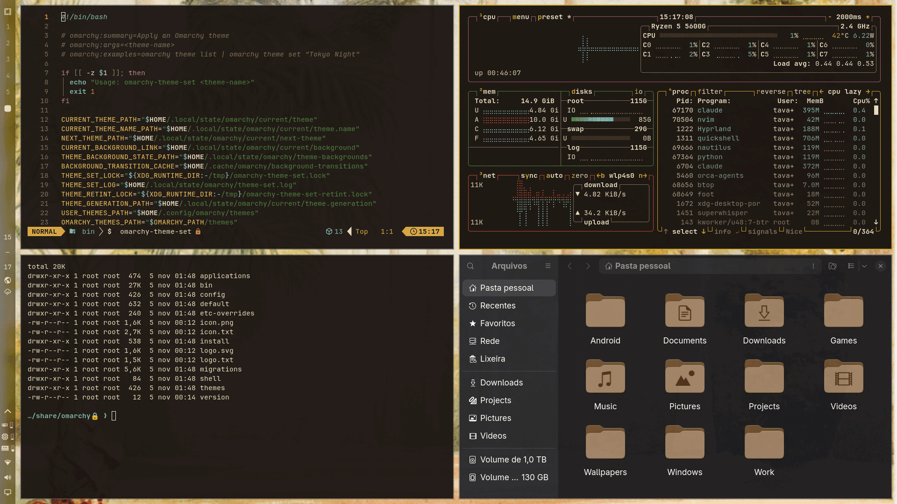

# Monarchy — Brasil Imperial

Tema escuro para o [Omarchy](https://omarchy.org) com paleta derivada de pinturas históricas do Império do Brasil
(Victor Meirelles, Pedro Américo, Debret e outros), com 15 wallpapers. Créditos das obras em [CREDITS.md](CREDITS.md).



## Instalação

```bash
omarchy theme install https://github.com/Tavaressan/omarchy-monarchy-theme
omarchy theme set Monarchy
```

## Extras opcionais

O Omarchy não aplica protetor de tela nem rotação de wallpaper por tema, então estes dois extras
são instalados à parte, com um script:

```bash
cd ~/.config/omarchy/themes/monarchy
bash install-extras.sh                  # instala os dois
bash install-extras.sh --screensaver    # só o protetor de tela
bash install-extras.sh --rotate         # só a rotação de wallpaper
bash install-extras.sh --uninstall      # desfaz (combine com --screensaver ou --rotate)
```

### Protetor de tela
Copia `screensaver.txt` (arte ASCII do brasão imperial) para `~/.config/omarchy/branding/screensaver.txt`.
Seu protetor atual, se for diferente, é salvo como `screensaver.txt.bak-antes-monarchy`.
Teste com `SUPER + CTRL + S`. Para voltar ao padrão: `bash install-extras.sh --uninstall --screensaver`.

### Rotação de wallpaper
Cria um timer de usuário do systemd (`monarchy-bg-rotate.timer`) que roda `omarchy-theme-bg-next`
a cada 15 minutos, **somente enquanto o tema ativo for o Monarchy**.
Para mudar o intervalo, edite `OnUnitActiveSec` em `~/.config/systemd/user/monarchy-bg-rotate.timer`
e rode `systemctl --user daemon-reload && systemctl --user restart monarchy-bg-rotate.timer`.

A ordem é alfabética (01, 02, …, 15) e volta ao início no fim da lista.
Troca manual: `omarchy theme bg next`.

## Conteúdo

| Arquivo | Função |
|---|---|
| `colors.toml` | Paleta do tema |
| `backgrounds/` | 15 wallpapers (créditos em `CREDITS.md`) |
| `CREDITS.md` | Autoria e fonte de cada obra |
| `icons.theme` | Tema de ícones (Yaru-warty-brown) |
| `screensaver.txt` | Protetor de tela (extra) |
| `extras/` | Unidades systemd da rotação (extra) |
| `install-extras.sh` | Instalador dos extras |
